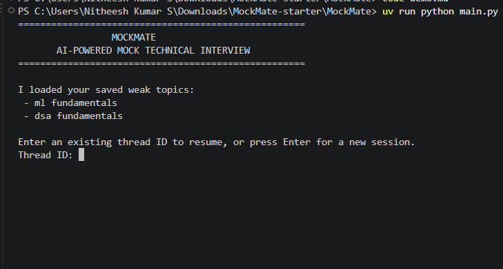

# MockMate - An AI-Powered Mock Technical Interview Agent

MockMate is a terminal-based AI interviewer built with Python, LangChain, LangGraph, and Deep Agents. It conducts technical mock interviews by asking one question at a time, evaluating candidate answers using a structured Pydantic scorecard, tracking weak topics, and adapting future questions based on previous performance.

## Features
- AI-powered technical interview question generation.
- One question at a time for a realistic interview experience.
- Structured answer evaluation using Pydantic scorecards.
- Performance scoring with feedback and improvement suggestions.
- Automatic weak-topic identification.
- Adaptive questioning based on previous interview performance.
- Interview session persistence and resume support.
- LangGraph checkpoint-based conversation memory.
- Deep Agents workspace assistant.
- Behavioural interview support using the STAR method.
- Workspace path validation and file-operation security.
- User approval before saving or modifying weak-topic records.

## Technology Stack
- **Language:** Python 3.12+
- **Package Manager:** uv
- **LLM Framework:** LangChain
- **Agent Workflow:** LangGraph
- **Agent Architecture:** Deep Agents
- **Data Validation:** Pydantic
- **Session Storage:** SQLite
- **Model Provider:** OpenRouter (OpenAI-compatible API)

## Project Structure
```text
MockMate/
│
├── main.py
├── pyproject.toml
├── uv.lock
├── .env.example
├── .gitignore
├── README.md
├── demo.md
│
├── skills/
│   └── behavioural/
│       └── SKILL.md
│
├── src/
│   └── mockmate/
│       ├── __init__.py
│       ├── config.py
│       ├── model.py
│       ├── schemas.py
│       ├── prompts.py
│       ├── security.py
│       ├── memory.py
│       ├── evaluator.py
│       ├── agent.py
│       ├── deep_workspace.py
│       ├── approval.py
│       └── cli.py
│
├── workspace/
│   ├── sessions/
│   ├── skills/
│   └── weak-topics.example.md
│
└── tests/
    ├── test_security.py
    ├── test_schemas.py
    ├── test_approval.py
    └── test_memory.py
```

## Requirements
- Python 3.12 or later
- Git
- uv package manager
- An API key from a supported model provider

## Installation and Setup

### 1. Clone the repository
```bash
git clone https://github.com/nitheeshkumar-s-10/Mockmate.git
cd Mockmate
```

### 2. Install dependencies
```bash
uv sync
```

### 3. Configure environment variables
Create a `.env` file in the project root using `.env.example` as a reference.

Example configuration:

```env
MODEL_PROVIDER=openai
MODEL_NAME=openrouter/free
MODEL_API_KEY=your_api_key_here
MODEL_BASE_URL=https://openrouter.ai/api/v1
MODEL_TEMPERATURE=0.2
```

Replace `your_api_key_here` with your own API key. Never share or commit your `.env` file.

### 4. Run MockMate
```bash
uv run python main.py
```

## How It Works
1. **Interview Initialization:** MockMate starts a new interview or resumes an existing session.
2. **Weak Topic Loading:** Previously identified weak topics are loaded from the workspace.
3. **Question Generation:** The AI generates a technical question based on the selected topic and candidate performance.
4. **Answer Submission:** The candidate enters an answer in the terminal.
5. **Answer Evaluation:** The AI evaluates the answer using a structured scorecard.
6. **Performance Tracking:** MockMate identifies weak areas and provides feedback.
7. **Approval Mechanism:** The candidate can approve, edit, or reject proposed weak-topic updates.
8. **Adaptive Learning:** Saved weak topics influence future interview questions.

## Answer Evaluation
MockMate evaluates answers using a structured scorecard that considers:

- Technical correctness
- Conceptual understanding
- Completeness
- Clarity of explanation

The evaluation provides a score, feedback, identified gaps, and suggestions for improvement.

## Workspace Assistant
MockMate integrates Deep Agents to provide workspace assistance.

The workspace assistant can:

- Summarize interview sessions.
- Review saved interview information.
- Provide behavioural interview guidance.
- Use the STAR method for behavioural questions.

Workspace operations are restricted to the application's workspace directory.

## Session Memory
MockMate uses LangGraph checkpointing with SQLite to maintain interview session state.

This allows users to resume previous interview sessions using their thread IDs.

## Testing
Run the automated test suite:

```bash
uv run pytest -q
```

The tests cover:
- Workspace path security.
- Pydantic schema validation.
- Approval mechanisms.
- Interview memory and session persistence.

## Future Improvements
- Voice-based mock interviews.
- Web-based interview dashboard.
- Interview performance analytics.
- Difficulty adjustment based on candidate performance.
- More technical interview categories.
- Exportable interview reports.

## Author
**Nitheesh Kumar S**
GitHub: https://github.com/nitheeshkumar-s-10
LinkedIn: https://www.linkedin.com/in/nitheesh-kumar-s/

---

**MockMate - Practice. Evaluate. Improve.**

## Screenshots

### MockMate Application

